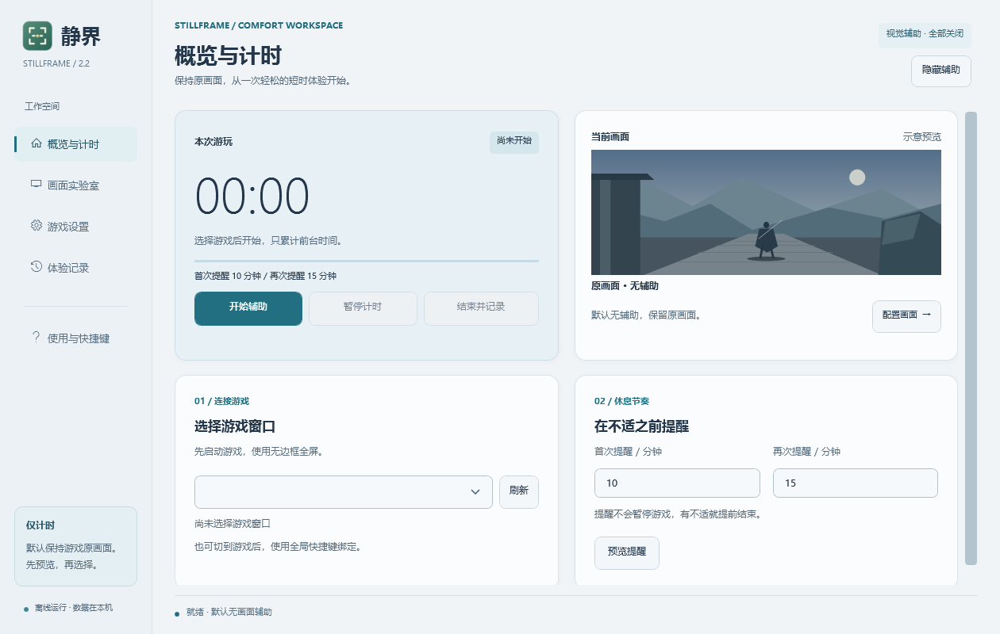
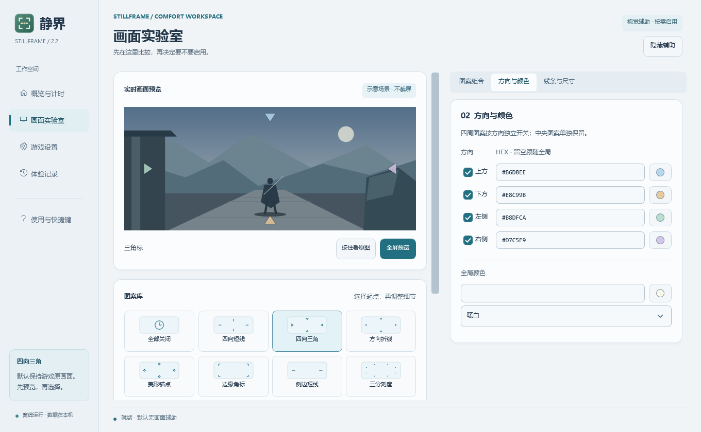

# 静界 · StillFrame

**适用于 Windows 11 的离线游戏舒适辅助工具。** 用固定视线参考、前台计时和休息提醒，帮助你比较不同设置下的游玩感受。首次启动时，所有画面辅助默认关闭。

[下载 Windows x64 便携版](https://github.com/dindding17/StillFrame/releases/latest) · [使用指南](docs/使用指南.md) · [常见问题](docs/常见问题.md) · [更新日志](CHANGELOG.md)



## 三步开始

1. 在 Releases 下载 `StillFrame-2.2.0-win-x64.zip`，完整解压并运行 `StillFrame.exe`。便携包包含所需运行库。升级前请先从托盘退出旧版。
2. 将游戏切换为**无边框全屏**。在“概览与计时”刷新并选择游戏窗口，点击“开始辅助”。默认只在游戏处于前台时计时，10 和 15 分钟分别提醒一次。
3. 想尝试参考图案时，打开“画面实验室”先比较预览。建议一次只开一种；有不适就结束。结束时可自愿记录感受，下次用相近场景对比。

## 画面实验室

图库有 12 种视觉参考预设，包括四向短线、三角标、折线、菱形、边缘角标和中心空心环。上下左右可以独立开关、单独配色；可调整线宽、透明度、线型和标记大小。按住“看原图”可对比，另支持临时全屏预览。



## 兼容性与数据

- 目标平台为 Windows 11 x64，优先使用 SDR 无边框全屏。独占全屏、HDR 或受保护画面可能限制覆盖层。
- 程序不注入游戏、不拦截输入、不截取游戏画面。设置和体验记录保存在本机，可导出 CSV。
- 视觉运动与身体感受不一致，可能引发 3D 游戏中的恶心或头晕。固定图案旨在提供屏幕参照；实际缓解效果因人而异。静界不是医疗工具。
- 参见[实际设备验证清单](docs/家中电脑验证清单.md)和[验证报告](docs/验证报告.md)。如有兼容问题，可提交 [Issue](https://github.com/dindding17/StillFrame/issues)。

## 从源码构建

需要 Windows 和 [.NET 10 SDK](https://dotnet.microsoft.com/download/dotnet/10.0)。在仓库根目录运行：

```powershell
.\build.ps1
```

脚本运行核心检查并生成自包含 Windows x64 便携包、源码包和 SHA256 校验值，输出至 `artifacts/`。

源码与文档采用 [MIT 许可证](LICENSE)；运行库许可见 [第三方声明](THIRD-PARTY-NOTICES.md)。
